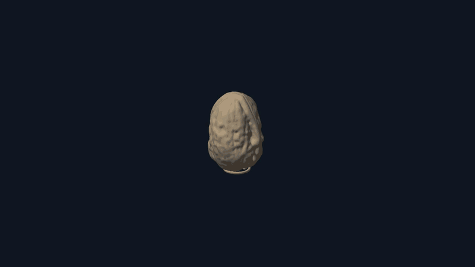
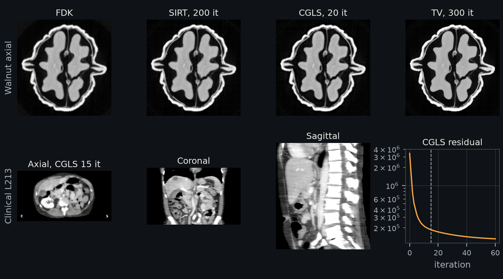

<h1 align="center">diffct</h1>

<p align="center">English · <a href="https://github.com/sypsyp97/diffct/blob/main/README.zh.md">简体中文</a></p>

<p align="center">
  <strong>Put real CT geometry inside a PyTorch training loop.</strong><br>
  Differentiable CT projection and matched backprojection operators for arbitrary scanner trajectories — from CPU experiments to multi-node CUDA reconstruction.
</p>

<p align="center">
  <a href="https://opensource.org/licenses/Apache-2.0"></a>
  <a href="https://doi.org/10.5281/zenodo.14999333"></a>
  <a href="https://pypi.org/project/diffct/"></a>
  <a href="https://sypsyp97.github.io/diffct/"></a>
  <a href="https://github.com/sypsyp97/diffct/actions"></a>
  <a href="https://deepwiki.com/sypsyp97/diffct"></a>
</p>

<p align="center">
  
</p>

<p align="center">
  Video overview of trajectories, autograd, geometry gradients, multi-GPU execution and measured walnut reconstruction · <a href="https://github.com/sypsyp97/diffct/blob/main/docs/assets/diffct_intro.mp4">MP4</a>.<br>
  Walnut data: Meaney 2022, Zenodo 6986012, CC BY 4.0; see <a href="https://github.com/sypsyp97/diffct/blob/main/examples/data/NOTICE">examples/data/NOTICE</a>.
</p>

<p align="center">
  <a href="#why-diffct">Why diffct</a> ·
  <a href="#install">Install</a> ·
  <a href="#quickstart">Quickstart</a> ·
  <a href="#results">Results</a> ·
  <a href="#where-to-go-next">Next steps</a> ·
  <strong><a href="https://sypsyp97.github.io/diffct/">Full documentation</a></strong>
</p>

> **Version 2.x** uses per-view trajectories; code written for 1.x needs [migration](https://sypsyp97.github.io/diffct/migration.html). This README tracks the source checkout; features under [Unreleased](https://github.com/sypsyp97/diffct/blob/main/CHANGELOG.md#unreleased) require installation from source.

## Why diffct

diffct is for researchers building learned reconstruction, geometry calibration and inverse-problem methods in PyTorch. It is designed around one combination: arbitrary per-view acquisition geometry, autograd through the volume and geometry, and execution that scales to measured clinical scans.

- **PyTorch-native operators.** `project()` and `backproject()` form a matched adjoint pair for the cell-constant Siddon model. Both support autograd, Hessian-vector products and ordinary PyTorch training loops.
- **Real scanner geometry.** Circular, helical, saddle, calibrated and measured clinical trajectories use the same per-view tensors; curved detectors and flying focal spot offsets can be represented without rebinning to a circular orbit.
- **Reconstruction and learning.** `cgls`, `sirt`, `tv_reconstruction`, differentiable FBP/FDK and gradient-based optimization share the same operators.
- **Large scans.** Automatic chunking, disk-backed state, multi-GPU and multi-node execution scale beyond one GPU's memory.

Technical report: [diffct: Differentiable CT Operators from Circular Orbits to Arbitrary Trajectories](https://doi.org/10.20944/preprints202605.1446.v2).

## Install

diffct needs Python 3.10 or newer and a PyTorch build for your device. For the native NVIDIA CUDA path, install PyTorch first, check its CUDA version, then install the matching extra:

```bash
python -c "import torch; print(torch.version.cuda)"   # 12.x or 13.x

# Pick the extra matching torch.version.cuda:
pip install "diffct[cu12]"    # CUDA 12.x
pip install "diffct[cu13]"    # CUDA 13.x
```

For CPU, PyTorch ROCm or Apple Silicon (MPS), use plain `pip install diffct` and `backend="torch"`. Apple Silicon runs through the built-in MPS support; a community [MLX port by Linda-Sophie Schneider](https://github.com/Linda-SophieSchneider/DiffCT-MLX) also exists. CUDA compatibility notes and source installation: [installation guide](https://sypsyp97.github.io/diffct/installation.html).

## Quickstart

Project an image, apply the matched adjoint and compute a gradient:

```python
import torch
from diffct import Projector, circular_trajectory_2d_parallel

trajectory = circular_trajectory_2d_parallel(180, device="cpu")
A = Projector(trajectory, (64, 64), 96, beam="parallel",
              detector_spacing=1.0, voxel_spacing=1.0)

image = torch.zeros(A.volume_shape, device="cuda", dtype=torch.float32)
image[20:44, 20:44] = 1.0
measurements = A.project(image)        # (180, 96)
adjoint = A.backproject(measurements)  # (64, 64), not an inverse

estimate = torch.zeros_like(image, requires_grad=True)
loss = 0.5 * (A.project(estimate) - measurements).square().sum()
loss.backward()
print(measurements.shape, estimate.grad.shape)
```

Expected output: `torch.Size([180, 96]) torch.Size([64, 64])`. CPU and Apple Silicon variants are in the [quickstart guide](https://sypsyp97.github.io/diffct/quickstart.html).

## Results

**Measured reconstruction, from bench phantom to clinical scan.** The walnut row compares FDK, SIRT, CGLS and TV on 240 measured circular cone-beam views. The clinical row shows liver case L213 of the Mayo Clinic 2020 low-dose CT dataset (LDCT-and-Projection-data), acquired on a GE scanner: full-dose projections, 7140 views, 888 × 64 cylindrical detector, reconstructed with 1 mm voxels using unregularized CGLS. The clinical slices show iteration 15; the residual curve runs to iteration 60. See the [measured walnut](https://sypsyp97.github.io/diffct/walnut_example.html), [clinical helical CT](https://sypsyp97.github.io/diffct/clinical_helical_example.html) and [Mayo public datasets](https://sypsyp97.github.io/diffct/mayo_datasets_example.html) examples.

<p align="center">
  <picture>
    <source srcset="docs/source/_static/gallery/readme_proof.png">
    
  </picture>
</p>

Walnut data: Meaney 2022, Zenodo 6986012, CC BY 4.0; see [examples/data/NOTICE](https://github.com/sypsyp97/diffct/blob/main/examples/data/NOTICE). Patient data: McCollough et al., *Low Dose CT Image and Projection Data (LDCT-and-Projection-data)*, Version 7, The Cancer Imaging Archive, 2020, [10.7937/9npb-2637](https://doi.org/10.7937/9npb-2637); dataset paper: Moen et al., Medical Physics, 2020, [10.1002/mp.14594](https://doi.org/10.1002/mp.14594). Chest and Liver subsets: [CC BY 4.0](https://creativecommons.org/licenses/by/4.0/); see [docs/assets/gallery/NOTICE](https://github.com/sypsyp97/diffct/blob/main/docs/assets/gallery/NOTICE).

**Multi-GPU scaling.** diffct 2.4.3, 512³ volume, FP32, A100 64 GB GPUs; circular cone beam, 360 views, 1024×768 detector, pitch 1.25:

| 512³ volume | 1 GPU | 4 GPUs, 1 node | 8 GPUs, 2 nodes |
|---|---:|---:|---:|
| Forward projection | 566.79 ms | 150.76 ms (3.8×) | 81.58 ms (6.9×) |
| Adjoint (backprojection) | 1060.77 ms | 279.37 ms (3.8×) | 224.04 ms (4.7×) |
| CGLS iteration | 1753.73 ms | 468.09 ms (3.7×) | 337.39 ms (5.2×) |

Methodology, chart and raw samples: [performance guide](https://sypsyp97.github.io/diffct/performance.html). More reconstruction examples: [examples](https://sypsyp97.github.io/diffct/examples.html).

## Where to go next

| I want to… | Start here |
|---|---|
| Run the first projection and gradient | [Quickstart](https://sypsyp97.github.io/diffct/quickstart.html) |
| Use a custom, calibrated or helical trajectory | [Trajectories and geometry](https://sypsyp97.github.io/diffct/trajectories.html) |
| Load Mayo clinical projections and images | [Mayo public datasets](https://sypsyp97.github.io/diffct/mayo_datasets_example.html) |
| Reconstruct measured clinical helical CT | [Clinical helical CT](https://sypsyp97.github.io/diffct/clinical_helical_example.html) |
| Scale across GPUs, nodes or limited memory | [Multi-GPU](https://sypsyp97.github.io/diffct/multi_gpu.html) · [Chunking](https://sypsyp97.github.io/diffct/chunking.html) |
| Train filters, weights or a volume with autograd | [Differentiable FBP/FDK](https://sypsyp97.github.io/diffct/analytical_learning.html) · [Gradient reconstruction](https://sypsyp97.github.io/diffct/gradient_reconstruction.html) |
| Look up execution contracts or API details | [Execution](https://sypsyp97.github.io/diffct/execution.html) · [API reference](https://sypsyp97.github.io/diffct/api.html) |
| Browse every reconstruction example | [Examples](https://sypsyp97.github.io/diffct/examples.html) |

## Citation

If you use diffct in your research, please cite both the software and the technical report. Machine-readable metadata is in [CITATION.cff](https://github.com/sypsyp97/diffct/blob/main/CITATION.cff).

<details>
<summary>BibTeX</summary>

```bibtex
@software{diffct2025,
  author    = {Yipeng Sun},
  title     = {diffct: Differentiable Computed Tomography Reconstruction with CUDA},
  year      = 2025,
  publisher = {Zenodo},
  doi       = {10.5281/zenodo.14999333},
  url       = {https://doi.org/10.5281/zenodo.14999333}
}

@article{202605.1446,
  doi       = {10.20944/preprints202605.1446.v2},
  url       = {https://doi.org/10.20944/preprints202605.1446.v2},
  year      = 2026,
  month     = {Oct},
  publisher = {Preprints},
  author    = {Yipeng Sun and Linda-Sophie Schneider and Chengze Ye and Andreas Maier},
  title     = {diffct: Differentiable CT Operators from Circular Orbits to Arbitrary Trajectories},
  journal   = {Preprints}
}
```

</details>

## License and acknowledgements

Apache 2.0, see [LICENSE](https://github.com/sypsyp97/diffct/blob/main/LICENSE). The project draws on [PYRO-NN](https://github.com/csyben/PYRO-NN) and [geometry_gradients_CT](https://github.com/mareikethies/geometry_gradients_CT). Issues and pull requests are welcome.
