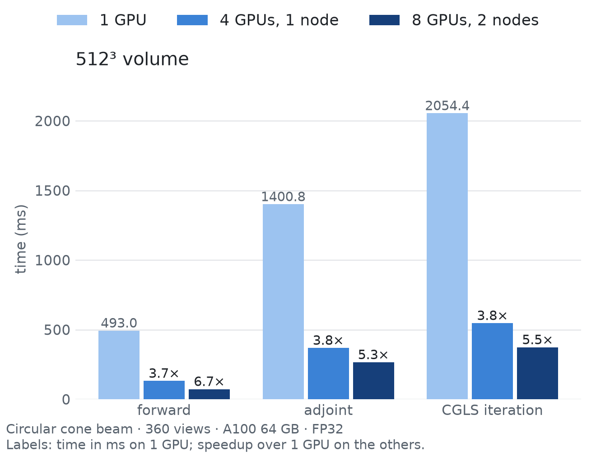

<h1 align="center">diffct</h1>

<p align="center"><a href="README.md">English</a> · 简体中文</p>

<p align="center">
  面向 CT 的可微 CUDA 投影算子：任意轨迹、多卡、多节点、几何梯度。
</p>

<p align="center">
  <a href="https://opensource.org/licenses/Apache-2.0"></a>
  <a href="https://doi.org/10.5281/zenodo.14999333"></a>
  <a href="https://pypi.org/project/diffct/"></a>
  <a href="https://sypsyp97.github.io/diffct/"></a>
  <a href="https://github.com/sypsyp97/diffct/actions"></a>
  <a href="https://deepwiki.com/sypsyp97/diffct"></a>
</p>

<p align="center">
  
</p>

<p align="center">
  <a href="https://github.com/sypsyp97/diffct/blob/main/docs/assets/diffct_intro.mp4">完整视频（MP4）</a> ·
  <a href="https://www.preprints.org/manuscript/202605.1446/v2">技术报告</a> ·
  <a href="https://doi.org/10.20944/preprints202605.1446.v2">DOI</a>
</p>

<p align="center">
  <a href="#安装">安装</a> ·
  <a href="#快速上手">快速上手</a> ·
  <a href="#性能">性能</a> ·
  <a href="#示例图">示例图</a> ·
  <a href="#示例">示例</a> ·
  <a href="#引用">引用</a>
</p>

> **2.0 版**用逐视角轨迹取代了 1.x 的圆轨迹接口。为 1.x 写的代码需要修改，见[迁移说明](docs/MIGRATION.md)。
> Apple Silicon 请使用 [Linda-Sophie Schneider 的 MLX 移植版](https://github.com/Linda-SophieSchneider/DiffCT-MLX)。

本 README 对应源码版本。[Unreleased](CHANGELOG.md#unreleased) 中列出的功能需要从源码安装。

## 为什么使用 diffct

据我们所知，diffct 是唯一同时具备以下四点的开源 GPU CT 库：任意逐视角轨迹、对体数据的自动求导、对采集几何的一阶梯度，以及内置的多卡和多节点执行。我们在 2026 年 10 月与 LEAP、TIGRE、ASTRA/tomosipo、DiffDRR 等库做了对比。

- **任意轨迹。** 每个视角有各自的射线方向或源点、探测器中心和探测器轴；圆轨迹、螺旋、鞍形、正弦、随机和标定扫描使用同一套代码。`requires_grad=True` 的轨迹张量可获得用于标定的几何梯度。
- **曲面探测器。** `ParameterizedSurface` 接收全局像素坐标、视角编号和显式参数，按批次生成弧形、柱面及其他曲面；原有 `detector_surface(u, v)` 回调仍可用。投影与匹配反投影支持曲面参数的一阶梯度。见[曲面接口](docs/REFERENCE.md#parameterized-detector-surfaces)（英文）。
- **匹配的算子。** `project()` 与 `backproject()` 对分片常数 Siddon 模型构成精确的伴随对；两者都支持 PyTorch 自动微分，包括体数据与正弦图的梯度和 Hessian 向量积。
- **大体积。** 按空间、视角和像素自动分块，传输缓冲有容量上限。`project_into`/`backproject_into` 可写入调用方的张量或磁盘存储；张量 autograd 接口仍保留完整输入、输出和梯度。见[分块执行](docs/REFERENCE.md#chunked-execution)（英文）。
- **多卡与多节点。** 单进程使用 `devices=[0, 1, 2, 3]`，或用 torchrun 与 NCCL。视角、空间和混合分区控制体数据与投影的复制。加速比取决于工作负载和通信开销。
- **精度与训练。** 显式选择原生/PyTorch 后端及 FP32/FP64 模式，支持各轴体素间距、batch/channel 和数据 `torch.func` 变换。可移植路径使用 CPU 或 PyTorch CUDA/ROCm；执行规则见[执行指南](docs/EXECUTION.md)（英文）。
- **求解器。** 库级 `cgls`、`sirt`、`tv_reconstruction` 支持残差历史、收敛阈值、回调，以及扫描和数据指纹绑定的完整 checkpoint；`cgls_into` 使用有界磁盘状态。
- **可微 FBP 和 FDK。** `fbp`、`fdk` 和近似螺旋重建 `helical_fdk` 组合公开的滤波器、权重和解析反投影。反向 kernel 转置实际的插值算子，可学习自定义 filter 和 weight。见[解析重建指南](docs/source/analytical_learning.rst)（英文）。

功能边界、限制和等中心规则见 [docs/REFERENCE.md](docs/REFERENCE.md#capabilities-and-limits)（英文）。

## 安装

使用原生路径时，先安装 NVIDIA CUDA 版 PyTorch，再按同一 CUDA 大版本安装 diffct：

```bash
python -c "import torch; print(torch.version.cuda)"    # 12.x 或 13.x
pip install "diffct[cu12]"    # PyTorch 为 CUDA 12 构建
pip install "diffct[cu13]"    # PyTorch 为 CUDA 13 构建
```

extra 安装 Numba 编译内核所需的 CUDA 库。CPU 或 PyTorch ROCm 路径先安装对应 PyTorch，再运行 `pip install diffct` 并选择 `backend="torch"`。导入 diffct 和使用该后端不需要 CUDA 运行时；原生执行时才初始化 Numba CUDA。原生路径已有兼容 CUDA Toolkit 时也可使用普通安装。

从源码安装（含示例）：

```bash
git clone https://github.com/sypsyp97/diffct.git
cd diffct && pip install -e ".[cu12]"
python examples/quickstart.py               # 打印每种射束的伴随误差和梯度
```

<details>
<summary>CUDA 版本说明</summary>

- Numba CUDA 导入 `numpy.row_stack`，NumPy 2.5 已删除该函数，所以保持 `numpy<2.5`。
- NVVM 和 NVJitLink 要与 PyTorch 加载的 CUDA 库兼容。较新的 NVVM 配较旧的
  NVJitLink 时，内核编译会失败。
- 已测试的 CUDA 13 组合：
  `pip install "numpy<2.5" "numba-cuda[cu13]" "cuda-toolkit[cccl,cudart,nvrtc,nvvm]==13.0.2" "nvidia-nvjitlink<13.1"`。
- 已测试的 CUDA 12 组合：PyTorch 2.10（cu126）加 `numba-cuda[cu12]` 0.30.4，驱动为 NVIDIA 535。

</details>

## 快速上手

先创建一次采集几何，再调用 `project()` 和 `backproject()`。

```python
import torch
from diffct import Projector, spiral_trajectory_3d

trajectory = spiral_trajectory_3d(360, sid=320.0, sdd=512.0, z_range=40.0, n_turns=1.0, device="cpu")
A = Projector(trajectory, volume_shape=(128, 128, 128), detector_shape=(384, 256), detector_spacing=0.8)

volume = torch.rand(A.volume_shape, device="cuda")
sinogram = A.project(volume)        # (360, 384, 256) 线积分
adjoint = A.backproject(sinogram)   # 匹配的伴随算子 A^T

x = torch.zeros_like(volume, requires_grad=True)
loss = 0.5 * (A.project(x) - sinogram).square().sum()
loss.backward()                     # x.grad = A^T (A x - y)
```

**自定义或标定轨迹。** 可直接传入标定得到的逐视角源点、探测器中心和方向轴张量，无需拟合圆轨迹。详见 [REFERENCE](docs/REFERENCE.md#custom-or-calibrated-trajectories)（英文）。

**几何梯度。** 用 `A.project(volume, trajectory=current)` 或 `A.backproject(sinogram, trajectory=current)` 复用同一个投影器。圆轨迹生成器接受可学习的角度张量，`transform_trajectory` 提供可微刚体变换；省略覆盖参数时继续使用构造时的轨迹。详见 [REFERENCE](docs/REFERENCE.md#geometry-gradients)（英文）。

**逐轴体素间距。** 按张量轴顺序设置 `voxel_spacing=(dy, dx)` 或 `(dz, dy, dx)`。两个后端都支持逐轴间距的投影、投影几何梯度及固定几何的 FBP/FDK。

**3D 平行束。** 使用 `circular_trajectory_3d_parallel(...)` 和 `beam="parallel3d"`，通过 PyTorch 后端在 CPU 或 CUDA 上执行匹配的前向投影和反向投影。

**原生体积布局。** 无 batch、平板锥束操作可设置 `native_volume_layout=True`，避免体积布局复制。这适用于单计算设备的原生完整 CUDA 路径。形状仍为 `(D, H, W)`，返回张量的步长采用内核布局；默认值为 `False`。限制见[分块执行](docs/REFERENCE.md#chunked-execution)（英文）。

**多卡与多节点。** 详见 [REFERENCE](docs/REFERENCE.md#several-gpus-and-nodes)（英文）和 [docs/DISTRIBUTED.md](docs/DISTRIBUTED.md)。

```python
A = Projector(trajectory, (128, 128, 128), (384, 256), detector_spacing=0.8, devices=[0, 1, 2, 3])
```

**体积超过显存容量。** 把数据放在 CPU，同一套接口会自动分块计算；CUDA
输入在估计的工作集能装下时保留完整体积路径。无需开启分块开关：

```python
A = Projector(trajectory, (128, 128, 128), (384, 256), detector_spacing=0.8)
volume = torch.ones(A.volume_shape, device="cpu", requires_grad=True)
sinogram = A.project(volume)                 # CPU 输出，CUDA 计算
sinogram.square().mean().backward()          # volume.grad 在 CPU
# 可选手动覆盖：volume_chunk_shape=(32, 64, 64), view_chunk_size=16
```

运行 `python examples/chunked_reconstruction.py` 可演示 CPU 数据上的 CGLS
并测量 CUDA 张量分配峰值。分块保持同一 Siddon 模型，但浮点求和顺序会变化；
更小的块可能增加传输和内核启动开销。张量数组及迭代状态仍需足够的主机内存。
超过主机内存时，运行 `python examples/disk_reconstruction.py --output disk-run`
使用磁盘状态和分片检查点；torchrun 下加 `--partition space` 固定各 rank 的体积归属。
运行 `python examples/benchmark_execution.py` 可比较调度、分块形状和实际传输量。

## 性能

<p align="center">
  <picture>
    <source media="(prefers-color-scheme: dark)" srcset="docs/assets/scaling_dark.png">
    
  </picture>
</p>

| 512³ 体数据 | 1 卡 | 4 卡，1 节点 | 8 卡，2 节点 |
|---|---:|---:|---:|
| 正投影 | 566.79 ms | 150.76 ms (3.8×) | 81.58 ms (6.9×) |
| 伴随（反投影） | 1060.77 ms | 279.37 ms (3.8×) | 224.04 ms (4.7×) |
| CGLS 迭代 | 1753.73 ms | 468.09 ms (3.7×) | 337.39 ms (5.2×) |

FP32，A100 64 GB GPU；圆形锥束，360 个视角，1024×768 探测器，pitch 1.25。采用默认内存设置，不额外限制分配器容量。

正投影与反投影各预热三次，再取七次计时的中位数。CGLS 预热两次迭代，再运行三组十次迭代；取包含初始化的耗时中位数，除以十。计时同步 CUDA，并取最慢 rank 的墙钟耗时。原始样本与配置见 [scaling.json](docs/assets/scaling.json)。

复现同一工作负载：

```bash
python examples/benchmark_scaling.py --output one.json
torchrun --standalone --nproc-per-node=4 examples/benchmark_scaling.py --expected-nodes 1 --output four.json
```

## 示例图

TV 指带全变分正则的迭代重建，Adam 是优化器。图中分别标注重建方法与优化器。

**实测核桃。** 240 个实测视角，圆形锥束，256³：FDK（Hann 窗）、SIRT（200 次迭代）、CGLS（20 次）、TV（300 次，权重 0.3）；轴向和冠状面中心切片。

<p align="center">
  
</p>

```bash
python examples/walnut_reconstruction.py --figure out.png
```

**核桃螺旋扫描模拟。** 以 FDK 核桃体数据为真值，720 个视角，1% 噪声，256³。PSNR：FDK 26.67 dB，CGLS（30 次迭代）34.13 dB，SIRT（200 次）34.52 dB，TV（200 次，权重 1.0）37.77 dB。

<p align="center">
  
</p>

```bash
python examples/walnut_reconstruction.py --algorithms --save-volume walnut256.npy
python examples/iterative_reconstruction.py --size 256 --views 720 --trajectory helical --noise 0.01 --phantom walnut256.npy --figure out.png
```

核桃数据：Meaney 2022，Zenodo 6986012，CC BY 4.0，见 [examples/data/NOTICE](examples/data/NOTICE)。

## 示例

`quickstart.py`、`curved_detector.py`、`chunked_reconstruction.py`、`disk_reconstruction.py`、`benchmark_execution.py`、`benchmark_trajectory_admission.py`、`benchmark_surface_geometry.py`、`benchmark_gpu_overheads.py`、`analytical_reconstruction.py`、`learnable_reconstruction.py`、`helical_fdk.py`、`iterative_reconstruction.py`、`walnut_reconstruction.py`、`geometry_calibration.py`、`benchmark_projector.py`、`benchmark_scaling.py`、`plot_trajectory.py`，以及 Slurm 模板 `slurm/multi_node.sbatch`。启动方式和分布式损失规则见 [examples/README.md](examples/README.md)。

## 文档

| 文档 | 内容 |
|---|---|
| [精度、训练与重建](docs/EXECUTION.md) | 后端模式、batch/间距约定、解析重建存储、混合分区损失归一化和求解器 checkpoint（英文） |
| [轨迹指南](docs/source/trajectories.rst) | 轨迹元组和 `Projector` 用法 |
| [docs/REFERENCE.md](docs/REFERENCE.md) | 功能边界、自定义轨迹、几何梯度、多卡细节、几何与单位（英文） |
| [docs/DISTRIBUTED.md](docs/DISTRIBUTED.md) | 执行与内存选择、分布式损失规则、Slurm 和跨节点检查 |
| [docs/MIGRATION.md](docs/MIGRATION.md) | 从仅支持圆轨迹的 API 迁移 |
| [docs/video/README.md](docs/video/README.md) | 动图视频的渲染方式 |
| [CHANGELOG.md](CHANGELOG.md) | 版本历史 |

在 CUDA 主机上运行测试：`python -m pytest tests/ -q`。

## 引用

如需引用本软件和技术报告，请使用以下 BibTeX：

```bibtex
@software{diffct2025,
  author    = {Yipeng Sun},
  title     = {diffct: Differentiable Computed Tomography Reconstruction with CUDA},
  year      = 2025,
  publisher = {Zenodo},
  doi       = {10.5281/zenodo.14999333},
  url       = {https://doi.org/10.5281/zenodo.14999333}
}

@article{202605.1446,
  doi       = {10.20944/preprints202605.1446.v2},
  url       = {https://doi.org/10.20944/preprints202605.1446.v2},
  year      = 2026,
  month     = {Oct},
  publisher = {Preprints},
  author    = {Yipeng Sun and Linda-Sophie Schneider and Chengze Ye and Andreas Maier},
  title     = {diffct: Differentiable CT Operators from Circular Orbits to Arbitrary Trajectories},
  journal   = {Preprints}
}
```

## 许可与致谢

许可：[Apache 2.0](LICENSE)。本项目参考了 [PYRO-NN](https://github.com/csyben/PYRO-NN) 和 [geometry_gradients_CT](https://github.com/mareikethies/geometry_gradients_CT)。欢迎提交 issue 和 pull request。核桃数据采用 CC BY 4.0 许可（Meaney 2022），见 [NOTICE](NOTICE)。
