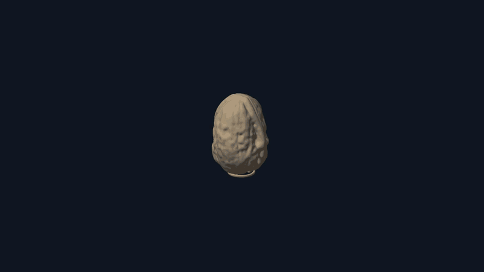
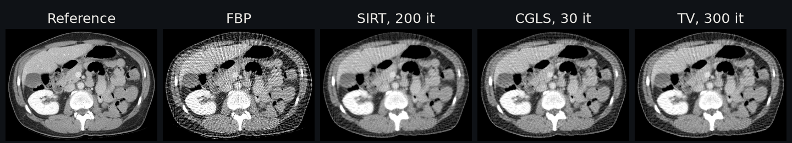
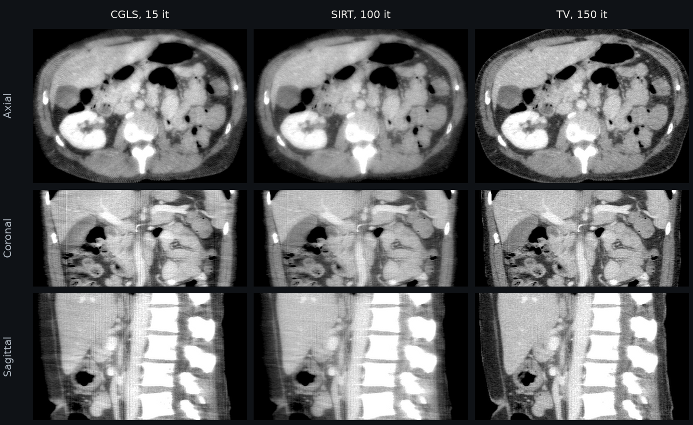

<h1 align="center">diffct</h1>

<p align="center"><a href="https://github.com/sypsyp97/diffct/blob/main/README.md">English</a> · 简体中文</p>

<p align="center">
  <strong>面向实测扫描几何的可微 CT 算子。</strong><br>
  diffct 在 PyTorch 中投影体数据、反投影测量数据、重建图像并标定扫描几何，从 CPU 实验扩展到多节点 CUDA 执行。
</p>

<p align="center">
  <a href="https://opensource.org/licenses/Apache-2.0"></a>
  <a href="https://doi.org/10.5281/zenodo.14999333"></a>
  <a href="https://pypi.org/project/diffct/"></a>
  <a href="https://sypsyp97.github.io/diffct/"></a>
  <a href="https://github.com/sypsyp97/diffct/actions"></a>
  <a href="https://deepwiki.com/sypsyp97/diffct"></a>
</p>

<p align="center">
  
</p>

<p align="center">
  视频展示轨迹、自动求导、几何梯度、多卡执行和实测核桃重建 · <a href="https://github.com/sypsyp97/diffct/blob/main/docs/assets/diffct_intro.mp4">MP4</a>。<br>
  核桃数据：Meaney 2022，Zenodo 6986012，CC BY 4.0，见 <a href="examples/data/NOTICE">examples/data/NOTICE</a>。
</p>

<p align="center">
  <a href="#算子">算子</a> ·
  <a href="#重建方法">重建方法</a> ·
  <a href="#实测螺旋-ct">临床 CT</a> ·
  <a href="#多卡扩展">多卡扩展</a> ·
  <a href="#安装">安装</a> ·
  <strong><a href="https://sypsyp97.github.io/diffct/">完整文档</a></strong>
</p>

> **2.x 版**使用逐视角轨迹。为 1.x 写的代码需要[迁移](https://sypsyp97.github.io/diffct/migration.html)（英文）。本 README 对应源码版本；[Unreleased](https://github.com/sypsyp97/diffct/blob/main/CHANGELOG.md#unreleased) 中列出的功能需要从源码安装。

## 算子

diffct 为 PyTorch 提供一对匹配的 CT 投影算子。轨迹张量指定每个视角的射线方向或源位置，以及探测器中心和轴向。圆轨迹、螺旋、鞍形、标定轨迹和实测临床轨迹使用相同的张量格式。

据我们所知，diffct 是唯一同时具备任意逐视角轨迹、体数据自动求导、一阶几何梯度和多节点执行的开源 GPU CT 库。我们于 2026 年 10 月核查了 LEAP、TIGRE、ASTRA/tomosipo、DiffDRR 等库。

- **匹配的伴随。** `project()` 与 `backproject()` 对分片常数 Siddon 模型构成精确的伴随对。`project()` 对输入体数据求导，`backproject()` 对输入测量数据求导。两者都支持 Hessian 向量积。
- **实测几何。** 逐视角源位置可包含 flying focal spot 偏移。`ParameterizedSurface` 可描述柱面等曲面探测器，无需重排。
- **重建。** `cgls`、`sirt`、`tv_reconstruction`、可微 FBP/FDK 和基于梯度的优化共享同一套算子。可微 FBP/FDK 可学习滤波器和权重。投影算子可为优化提供体数据梯度。
- **扩展。** 自动分块、磁盘状态和分布式执行让 diffct 重建超过单张 GPU 显存的扫描。

技术报告：[diffct: Differentiable CT Operators from Circular Orbits to Arbitrary Trajectories](https://doi.org/10.20944/preprints202605.1446.v2)。

## 重建方法

图中比较解析重建和迭代重建。模拟使用 Mayo 肝脏病例 L213 的腹部切片。模拟的扇形束投影含 120 个视角，无噪声。Reference 面板是厂商重建图像。其余面板为 FBP 和三种迭代方法。SIRT 迭代 200 次。CGLS 迭代 30 次。TV 正则化重建迭代 300 次，正则化权重为 0.3。

<p align="center">
  <picture>
    <source srcset="docs/source/_static/gallery/readme_methods.png">
    
  </picture>
</p>

<p align="center">
  患者图像来源：Mayo Clinic LDCT-and-Projection-data，肝脏病例 L213，CC BY 4.0。
</p>

## 实测螺旋 CT

diffct 重建了肝脏病例 L213 的实测螺旋扫描。GE 扫描仪采集了 7,140 个视角的全剂量投影。柱面探测器的尺寸为 888 × 64。图中三行分别为轴位、冠状位和矢状位。各列比较厂商图像、迭代 100 次的 SIRT、迭代 15 次的 CGLS 和迭代 150 次的 TV 正则化重建。两列 TV 的权重分别为 1 和 10。所有重建均使用 1 mm 体素。

<p align="center">
  <picture>
    <source srcset="docs/source/_static/gallery/readme_clinical.png">
    
  </picture>
</p>

患者数据：McCollough et al.，*Low Dose CT Image and Projection Data (LDCT-and-Projection-data)*，Version 7，The Cancer Imaging Archive，2020，[10.7937/9npb-2637](https://doi.org/10.7937/9npb-2637)。数据集论文：Moen et al.，Medical Physics，2020，[10.1002/mp.14594](https://doi.org/10.1002/mp.14594)。Chest 和 Liver 子集采用 [CC BY 4.0](https://creativecommons.org/licenses/by/4.0/) 许可，见 [docs/assets/gallery/NOTICE](docs/assets/gallery/NOTICE)。

## 多卡扩展

基准使用 512³ FP32 体数据、A100 64 GB GPU、圆形锥束、360 个视角、1024 × 768 探测器和 pitch 1.25。

| 512³ 体数据 | 1 卡 | 4 卡，1 节点 | 8 卡，2 节点 |
|---|---:|---:|---:|
| 正投影 | 566.79 ms | 150.76 ms (3.8×) | 81.58 ms (6.9×) |
| 伴随（反投影） | 1060.77 ms | 279.37 ms (3.8×) | 224.04 ms (4.7×) |
| CGLS 迭代 | 1753.73 ms | 468.09 ms (3.7×) | 337.39 ms (5.2×) |

[性能指南](https://sypsyp97.github.io/diffct/performance.html)给出方法、图表和原始样本。更多重建见[示例](https://sypsyp97.github.io/diffct/examples.html)（均为英文）。

## 安装

diffct 需要 Python 3.10 或更高版本。先安装与设备匹配的 PyTorch。

使用原生 NVIDIA CUDA 路径时，检查 PyTorch 构建所用的 CUDA 版本：

```bash
python -c "import torch; print(torch.version.cuda)"
```

当 `torch.version.cuda` 为 12.x 时，运行：

```bash
pip install "diffct[cu12]"
```

当 `torch.version.cuda` 为 13.x 时，运行：

```bash
pip install "diffct[cu13]"
```

CPU、PyTorch ROCm 或 Apple Silicon 安装不带 extra 的 diffct：

```bash
pip install diffct
```

可移植后端需选择 `backend="torch"`。Apple Silicon 通过内置 MPS 支持运行。Linda-Sophie Schneider 还有一个社区 [MLX 移植版](https://github.com/Linda-SophieSchneider/DiffCT-MLX)。CUDA 兼容性说明和源码安装见[安装指南](https://sypsyp97.github.io/diffct/installation.html)（英文）。

## 快速上手

创建一个投影算子。投影图像并反投影测量数据。然后计算损失对图像估计值的梯度：

```python
import torch
from diffct import Projector, circular_trajectory_2d_parallel

trajectory = circular_trajectory_2d_parallel(180, device="cpu")
A = Projector(trajectory, (64, 64), 96, beam="parallel",
              detector_spacing=1.0, voxel_spacing=1.0)

image = torch.zeros(A.volume_shape, device="cuda", dtype=torch.float32)
image[20:44, 20:44] = 1.0
measurements = A.project(image)        # (180, 96)
adjoint = A.backproject(measurements)  # (64, 64), not an inverse

estimate = torch.zeros_like(image, requires_grad=True)
loss = 0.5 * (A.project(estimate) - measurements).square().sum()
loss.backward()
print(measurements.shape, estimate.grad.shape)
```

预期输出：`torch.Size([180, 96]) torch.Size([64, 64])`。CPU 和 Apple Silicon 版本见[快速上手指南](https://sypsyp97.github.io/diffct/quickstart.html)（英文）。

## 文档

[快速上手](https://sypsyp97.github.io/diffct/quickstart.html) · [轨迹与几何](https://sypsyp97.github.io/diffct/trajectories.html) · [临床螺旋 CT](https://sypsyp97.github.io/diffct/clinical_helical_example.html) · [Mayo 公开数据集](https://sypsyp97.github.io/diffct/mayo_datasets_example.html) · [多卡执行](https://sypsyp97.github.io/diffct/multi_gpu.html) · [API 参考](https://sypsyp97.github.io/diffct/api.html) · [示例](https://sypsyp97.github.io/diffct/examples.html)（均为英文）

## 引用

如需引用 diffct，请同时引用软件和技术报告。机器可读元数据见 [CITATION.cff](https://github.com/sypsyp97/diffct/blob/main/CITATION.cff)。

<details>
<summary>BibTeX</summary>

```bibtex
@software{diffct2025,
  author    = {Yipeng Sun},
  title     = {diffct: Differentiable Computed Tomography Reconstruction with CUDA},
  year      = 2025,
  publisher = {Zenodo},
  doi       = {10.5281/zenodo.14999333},
  url       = {https://doi.org/10.5281/zenodo.14999333}
}

@article{202605.1446,
  doi       = {10.20944/preprints202605.1446.v2},
  url       = {https://doi.org/10.20944/preprints202605.1446.v2},
  year      = 2026,
  month     = {Oct},
  publisher = {Preprints},
  author    = {Yipeng Sun and Linda-Sophie Schneider and Chengze Ye and Andreas Maier},
  title     = {diffct: Differentiable CT Operators from Circular Orbits to Arbitrary Trajectories},
  journal   = {Preprints}
}
```

</details>

## 许可与致谢

Apache 2.0，见 [LICENSE](https://github.com/sypsyp97/diffct/blob/main/LICENSE)。项目借鉴了 [PYRO-NN](https://github.com/csyben/PYRO-NN) 和 [geometry_gradients_CT](https://github.com/mareikethies/geometry_gradients_CT)。欢迎提交 issue 和 pull request。
