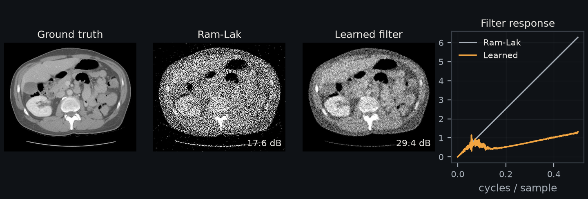

Differentiable analytical reconstruction
===========================================

``Projector.project`` and ``Projector.backproject`` implement the cell-constant
Siddon forward operator and its matched adjoint. Analytical FBP and FDK use a
different, voxel-driven interpolation operator. Its backward pass scatters the
same interpolation coefficients, including distance weights and normalization.
It does not substitute the Siddon projector for the analytical transpose.

   Abdominal slice of TCIA case L213 at 256² (see :ref:`data-sources`), parallel
   beam, 360 views, 2% noise, 200 Adam steps on the filter only. These settings
   differ from ``examples/learnable_reconstruction.py`` below.

The reconstruction APIs return signed images in the selected precision on the
input device. Clamping is a caller decision. In the default native fast mode,
low-precision measurements are promoted to float32 before geometry,
weighting and FFT operations; gradients retain the original input/parameter dtype.
Sinogram, filter and explicit weight gradients propagate through the
pipeline, including higher derivatives with respect to those tensors. Acquisition
geometry and isocenter are fixed; trainable geometry is rejected explicitly.
Use the Siddon ``Projector`` for geometry calibration.

Short-scan distance and offset checks account for physical coordinate scale and
the original trajectory precision, including when float32 geometry is promoted
for float64 measurements. Each check uses only the trajectory components involved
in its calculation; detector-v precision cannot relax the detector-u offset check.
Each source/detector coordinate and detector-axis component counts with its own
rounding along the checked direction, and each allows twice the largest two-view
change that this rounding can cause. Axis components have half the smallest
subnormal as a rounding floor. Eight eps of the in-plane ray length covers
arithmetic and orbit rounding. Both checks also allow a relative tolerance of
1e-4, and the absolute tolerance is at least 1e-5. A change smaller than these
bounds cannot be told apart from rounding: low-precision or far-translated
coordinates that have a component along the checked direction widen the check.
Helical slice centers use float64 independently of
the angle dtype; low-precision angles do not round physical voxel coordinates.

``fbp`` and ``fdk`` support flat detectors, portable FP32/FP64 arithmetic,
view/spatial chunks, several local devices, distributed views/space/hybrid
ownership and numerical ``fbp_into``/``fdk_into`` stores; see :doc:`execution`.
The helical approximation and low-level CUDA helpers retain their original
execution contracts. FDK is an approximate inverse even though its implemented
discrete backward pass transposes the interpolation coefficients.

Use the complete APIs with the same trajectory tensors as ``Projector``:

.. code-block:: python

   from diffct import fbp, fdk, helical_fdk

   image = fbp(sino2d, trajectory2d, (H, W), angles,
               beam="fan", detector_spacing=du, isocenter=(0, 0))
   volume = fdk(sino3d, trajectory3d, (D, H, W), angles,
                detector_spacing=(du, dv), isocenter=(0, 0, 0))
   helical = helical_fdk(sino3d, helix, (D, H, W), unwrapped_angles,
                         detector_spacing=(du, dv), isocenter=(0, 0, 0))

Sinograms use ``(views,U)`` or ``(views,U,V)``; images use ``(H,W)`` or
``(D,H,W)``. Distances, pitches and isocenter share one physical unit.
``projection_weights`` replaces the complete pre-filter cosine weight;
``angular_weights`` replaces angular quadrature in ``fbp``/``fdk``.
``filter_response`` replaces the full real rFFT multiplier, already scaled
in physical units, with length ``pad_factor*U//2+1``. It overrides ``window``.
For circular fan/cone short scans, ``short_scan=True`` adds Parker weighting
before filtering and checks the circular orbit and required angular span.
Native curved data needs covered flat-detector resampling before these APIs.

Building and learning a pipeline
-------------------------------------

Run the examples from a source checkout:

.. code-block:: bash

   python examples/analytical_reconstruction.py --size 64
   python examples/learnable_reconstruction.py --beam parallel --size 32
   python examples/learnable_reconstruction.py --beam fan --size 32
   python examples/learnable_reconstruction.py --beam cone --size 32
   python examples/helical_fdk.py --size 32

``learnable_reconstruction.py`` shows the full pipeline in ordinary PyTorch:
detector cosine weights, a trainable frequency response, FFT filtering, angular
quadrature and the analytical gather. It optimizes the filter and projection
weights for FBP or FDK on a synthetic noisy phantom. This demonstrates
autograd and composition; the fitted parameters are specific to the example.

Helical approximation
---------------------

``helical_fdk`` filters detector rows once, then reconstructs each axial slice
from a full turn centered at the angle where the source crosses that slice.
``helical_view_weights`` exposes those per-slice quadrature weights.
``helical_weighted_backproject`` accepts replacement weights after filtering,
so users can learn or replace this stage independently.

This is a native flat-detector, slice-windowed FDK approximation for an axial
helix with radial detector normals. It is not an implementation of exact
Katsevich inversion, cone-parallel rebinning or conjugate-ray 3D weighting.
The source-z samples and explicit unwrapped angles determine the window;
nominal pitch parameters are not substituted for the actual acquisition.
Incomplete angular windows are rejected. Detector truncation remains possible
and the example uses a detector tall enough to cover its selected windows.

The full-turn window and half redundancy factor are motivated by equation 14
of `Kong et al. (2018)
<https://pmc.ncbi.nlm.nih.gov/articles/PMC6269102/>`_. That paper derives the
formula after cone-parallel rebinning; applying the window directly to the
native cone gather here is an approximation. Increasing pitch or cone angle
can increase reconstruction error.

The implementation processes one slice at a time, keeping the window stage
readable and avoiding a views-by-volume weight tensor. This trades kernel-launch
overhead for bounded temporary storage; inputs, outputs and autograd state
still reside on the CUDA device.

Example results
---------------

The 32-voxel learning examples use 180 views and 20 Adam steps on a synthetic
phantom with Gaussian projection noise. These training results are specific to
that example:

.. list-table::
   :header-rows: 1

   * - Beam
     - Initial PSNR
     - Learned filter/weight PSNR
   * - Parallel FBP
     - 31.96 dB
     - 33.81 dB
   * - Fan FBP
     - 29.90 dB
     - 32.86 dB
   * - Cone FDK
     - 30.24 dB
     - 32.09 dB

The 32-cubed, 720-view, four-turn helical example gives 32.99 dB. The integration
weights of each slice sum to pi. Manual composition and the complete API agree
within 4e-7. Float32 atomic accumulation order depends on the GPU, so the last
digit of these values can change.
