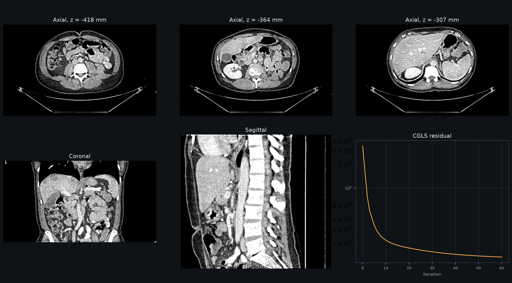
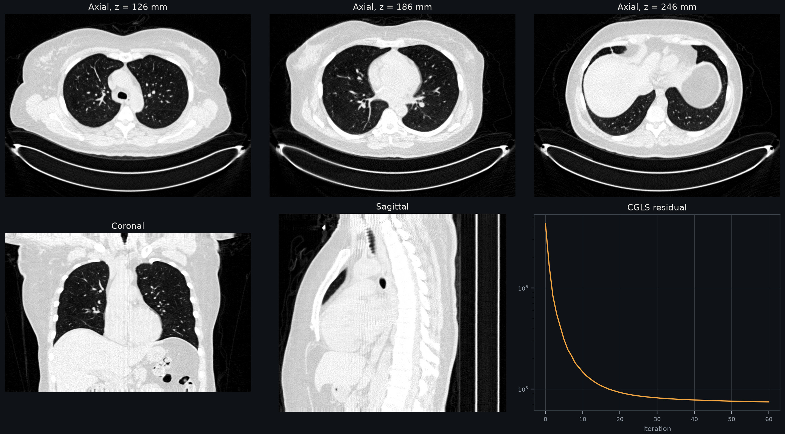
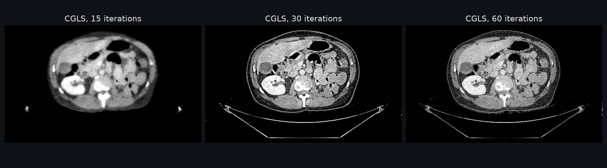

Clinical Helical CT
===================

This example reconstructs measured projections of two patients from a clinical
helical CT scanner. The data are the full-dose projections of
LDCT-and-Projection-data (see :ref:`data-sources`). Each view is one detector
readout in the DICOM-CT-PD format.

   Case L213 (abdomen, GE): 7140 views, 888 × 64 cylindrical detector, 1 mm voxels,
   30 CGLS iterations without regularization. Soft-tissue window.

   Case C002 (chest, Siemens, flying focal spot): 11072 views, 736 × 64 cylindrical
   detector, 1 mm voxels, 30 CGLS iterations without regularization. Lung window.

Geometry
--------

The scanner geometry goes to ``Projector`` as per-view tensors, without
rebinning to a circular orbit or a flat detector:

- **Source:** the focal spot of each view, including the flying focal spot
  offsets in angle, radius and z.
- **Detector:** a cylindrical surface centred on the nominal focal spot, given
  as a ``detector_surface`` callback. Projection and backprojection use these
  pixel positions directly.
- **Views:** the views are split over the GPUs with ``distributed=True``;
  :func:`~diffct.solvers.cgls` runs on the distributed operator.

The detector column of the central ray was calibrated with geometry gradients:
368.56 for C002 and 442.2 for L213, as 0-based stored columns. For C002, the
calibrated value is within 0.07 columns of the scanner header.

.. literalinclude:: ../assets/gallery/compute.py
   :language: python
   :pyobject: helical
   :caption: docs/assets/gallery/compute.py

Effect of the iteration count
-----------------------------

CGLS without regularization first recovers structure, then amplifies noise.

Run it
------

1. Download the full-dose projection and image series of a Chest or Liver case
   from The Cancer Imaging Archive.
2. Convert one case to arrays:

   .. code-block:: bash

      pip install pydicom
      python docs/assets/gallery/ldct_prep.py <projection dir> <image dir> ldct/L213

3. Reconstruct on 8 GPUs:

   .. code-block:: bash

      torchrun --nproc-per-node=8 docs/assets/gallery/compute.py helical \
          --case ldct/L213 --center 442.2 --axial-z -418 -364 -307 --out arrays
