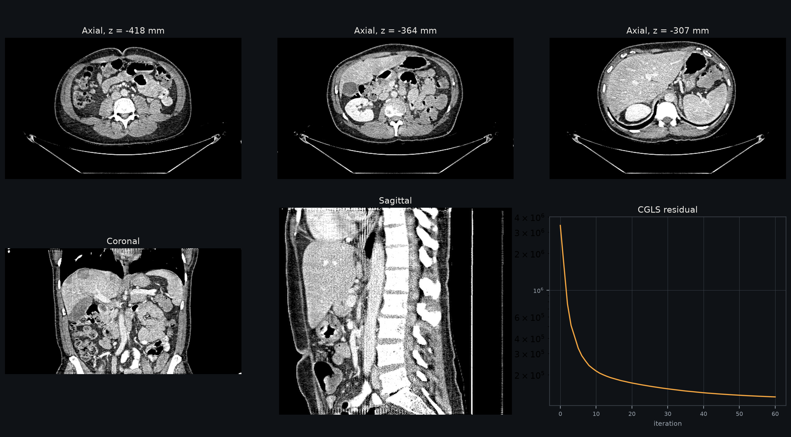

Clinical Helical CT
===================

This example reconstructs measured projections of patients from a clinical helical
CT scanner. The same script also reconstructs case C002 (chest, Siemens, flying
focal spot, 11072 views). The data are the full-dose projections of
LDCT-and-Projection-data (see :ref:`data-sources`). Each view is one detector
readout in the DICOM-CT-PD format.

   Case L213 (abdomen, GE): 7140 views, 888 × 64 cylindrical detector, 1 mm voxels,
   30 CGLS iterations without regularization. Soft-tissue window.

Geometry
--------

The scanner geometry goes to ``Projector`` as per-view tensors, without
rebinning to a circular orbit or a flat detector:

- **Source:** the focal spot of each view, including the flying focal spot
  offsets in angle, radius and z.
- **Detector:** a cylindrical surface centred on the nominal focal spot, given
  as a ``detector_surface`` callback. Projection and backprojection use these
  pixel positions directly.
- **Views:** the views are split over the GPUs with ``distributed=True``;
  :func:`~diffct.solvers.cgls` runs on the distributed operator.

The detector column of the central ray is 368.56 for C002 and 442.2 for L213, as
0-based stored columns. We estimated both values beforehand with gradient-based
calibration of the column offset; that calibration is not part of this script.

.. literalinclude:: ../assets/gallery/compute.py
   :language: python
   :pyobject: helical
   :caption: docs/assets/gallery/compute.py

Run it
------

1. Download the full-dose projection and image series of a Chest or Liver case
   from The Cancer Imaging Archive.
2. Convert one case to arrays:

   .. code-block:: bash

      pip install 'diffct[dicom]'
      python docs/assets/gallery/ldct_prep.py <projection dir> <image dir> ldct/L213

   Re-run preparation for older arrays: metadata now includes the detector
   shape and the scan's water attenuation, rather than assuming GE's value.

3. Reconstruct on 8 GPUs:

   .. code-block:: bash

      torchrun --nproc-per-node=8 docs/assets/gallery/compute.py helical \
          --case ldct/L213 --center 442.2 --axial-z -418 -364 -307 --out arrays

Library API (CPU or GPU)
------------------------

The reader accepts a directory or a list of projection files. Views are sorted
by InstanceNumber; sparse gaps are allowed, duplicates and changing detector
geometry are rejected. It reads already-corrected CT-PD data and applies each
file's rescale slope/intercept without taking another logarithm.

.. code-block:: python

   import torch
   from diffct import read_dicom_ct_pd, clinical_geometry, Projector, cgls

   scan = read_dicom_ct_pd("projections")
   geometry = clinical_geometry(scan)  # CPU float32, FFS enabled
   operator = Projector(
       geometry.trajectory, (32, 64, 64), geometry.detector_shape,
       detector_spacing=geometry.detector_spacing,
       detector_surface=geometry.detector_surface,
       voxel_spacing=4.0, backend="torch")
   measurements = torch.from_numpy(scan.projections) / scan.water_attenuation
   result = cgls(operator, measurements, iterations=6)

Size the volume and view/detector subset for available memory and CPU time.
The explicit division above normalizes the reconstruction to water units, in
which water is 1 and HU is ``1000 * (reconstruction - 1)``. Without that
division the reconstruction is absolute attenuation and needs
``attenuation_to_hu(reconstruction, scan.water_attenuation)`` instead.
``ClinicalScan`` is a frozen dataclass (its NumPy arrays remain mutable).
Geometry vectors are float64 in mm/radians; projections are float32 with shape
``(views, channels, rows)``. ``ClinicalGeometry`` contains the four named
Projector arguments shown above. ``z_center`` defaults to the midpoint of the
nominal source-z range. ``central_column`` overrides the zero-based header
column for calibrated data; ``flying_focal_spot=False`` removes all source
offsets. ``device`` and ``dtype`` control the returned trajectory tensors.

The detector frame remains nominal while the source receives all three
offsets, even if a mode named ``FFSZ`` also has radial/angular offsets. Stored
rows run opposite to v. Only cylindrical detectors are currently implemented;
other shapes raise NotImplementedError. Analytical FBP/FDK still require flat
data, and this API does not relax helical FDK's CUDA/constant-radius/monotone-z
restrictions. Patient-coordinate registration of vendor images remains a
separate step. Water calibration comes from CT-PD tag (7041,1001), e.g.
0.0192/mm for C002 versus 0.0186/mm for L213.
