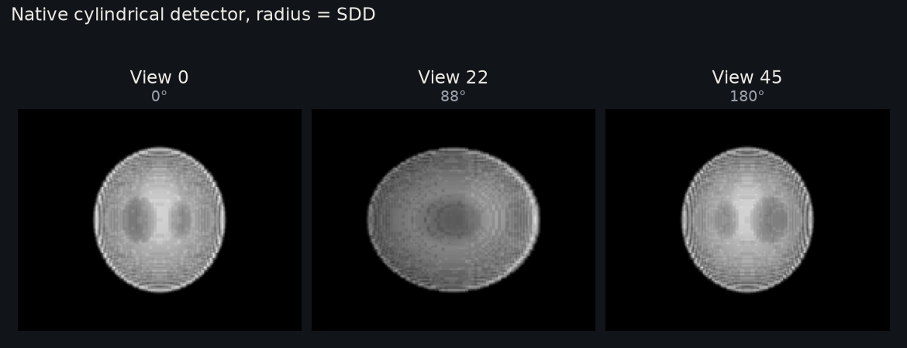

Native Curved Detector
======================

``examples/curved_detector.py`` projects a phantom onto a native cylindrical cone
detector, checks the matched backprojection and computes volume and surface
gradients on a circular scan.

   Rendered on CPU by ``docs/assets/make_gallery_figures.py`` with ``backend="torch"``.
   The geometry is the example's, scaled by two, with a 64³ phantom.

Run it
------

Run the commands from the root of a source checkout; ``pip install diffct`` does not
install the ``examples/`` directory. See the "From source" tab in
:doc:`getting_started`.

.. code-block:: bash

   python examples/curved_detector.py

This small CUDA example uses the native curved operators directly, without
resampling or FDK. See :ref:`detector-surfaces` for the callback contract.

Source
------

.. literalinclude:: ../../examples/curved_detector.py
   :language: python
   :linenos:
   :caption: Native cylindrical detector operators
