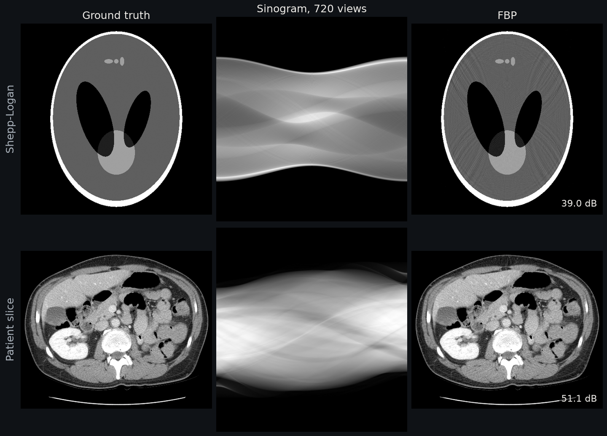

Parallel Beam Filtered Backprojection (FBP)
===========================================

This page describes the ``examples/analytical_reconstruction.py`` pipeline. For
filter options and helper signatures, see :doc:`api`.

   Ground truth: Shepp-Logan, and an abdominal slice of TCIA case L213 (see
   :ref:`data-sources`). 512², 720 views over 180°, 1536 detector bins at half the
   pixel size, Shepp-Logan window. PSNR in the lower corner.

Run it
------

Run the commands from the root of a source checkout; ``pip install diffct`` does not
install the ``examples/`` directory. See the "From source" tab in
:doc:`installation`. ``--figure`` needs Matplotlib: ``pip install matplotlib``.

.. code-block:: bash

   python examples/analytical_reconstruction.py --size 64 --window shepp-logan
   python examples/analytical_reconstruction.py --size 128 --figure analytical.png

The script runs parallel, fan and cone reconstruction on one CUDA GPU and prints
PSNR against the synthetic phantom. ``--figure`` requires Matplotlib. ``--window``
accepts ``ram-lak``, ``shepp-logan``, ``cosine``, ``hamming`` or ``hann``.

Pipeline
--------

The example uses a 180-degree parallel-beam scan with 360 views. The detector has
``3 * size`` cells and a pitch of 0.5 voxels.

1. Project a phantom slice with ``Projector(beam="parallel")``.
2. Filter along the detector dimension (``dim=1``) with
   ``ramp_filter_1d(..., sample_spacing=pitch, pad_factor=2)``.
3. Multiply by ``angular_integration_weights(half_turn,
   redundant_full_scan=False)``.
4. Call ``parallel_weighted_backproject`` on the sinogram's CUDA device.

The analytical helpers are not the ``Projector.backproject()`` adjoint. Do not
use the adjoint in this pipeline, and do not add extra scale factors. The helpers
apply their own normalization.

Source
------

.. literalinclude:: ../../examples/analytical_reconstruction.py
   :language: python
   :linenos:
   :caption: Parallel FBP, fan FBP and cone FDK
