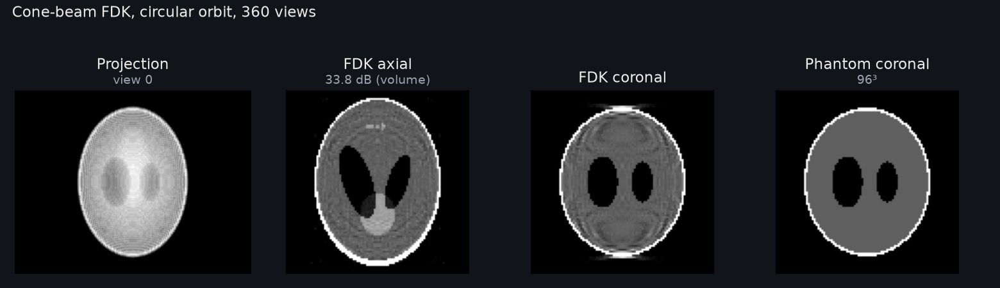

Cone Beam Feldkamp-Davis-Kress (FDK)
====================================

This page describes the cone-beam part of ``examples/analytical_reconstruction.py``.
For filter options and helper signatures, see :doc:`api`.

   3D Shepp-Logan phantom, 256³, 720 views on a circular orbit. The off-centre
   slice and the coronal section show the approximation error of FDK away from the
   orbit plane.

Run it
------

Run the commands from the root of a source checkout; ``pip install diffct`` does not
install the ``examples/`` directory. See the "From source" tab in
:doc:`installation`. ``--figure`` needs Matplotlib: ``pip install matplotlib``.

.. code-block:: bash

   python examples/analytical_reconstruction.py --size 64 --window shepp-logan
   python examples/analytical_reconstruction.py --size 128 --figure analytical.png

The script runs parallel, fan and cone reconstruction on one CUDA GPU and prints
PSNR against the synthetic phantom. ``--figure`` requires Matplotlib.

Pipeline
--------

The example uses a flat detector and a circular cone-beam scan with 360 views.
It does not reconstruct native curved-detector data directly. To reuse this
pipeline for a curved detector, first resample line integrals along matching
rays onto a covered virtual flat grid. This adds interpolation error; FDK still
retains its circular cone-beam approximation. For native curved projection and
matched backprojection, see :ref:`detector-surfaces` and :doc:`examples`.

The example projects a 3D phantom with ``Projector`` into a ``(views, U, V)``
sinogram. The helper ``examples/_common.py::fdk`` then calls :func:`diffct.reconstruction.fdk`,
which performs these steps:

1. Apply detector cosine weights computed from the actual per-view rays.
2. Filter along the detector u axis (``dim=1``) with ``sample_spacing=du``
   and ``pad_factor=2``. The last axis is v, not u.
3. Apply ``angular_integration_weights``. A full turn includes the ``1/2``
   redundancy factor.
4. Call ``cone_weighted_backproject``. The example clamps negative values to zero.

The same stages are public helpers. See :doc:`analytical_learning` to replace
or learn the weights and filter.

FDK is approximate for a circular cone-beam scan away from the central plane.
Large cone angles increase artifacts. On non-circular trajectories, FDK is a
heuristic baseline, not an exact reconstruction.

The analytical helpers are not the ``Projector.backproject()`` adjoint. Do not
use the adjoint in this pipeline, and do not add extra scale factors.

Source
------

.. literalinclude:: ../../examples/analytical_reconstruction.py
   :language: python
   :linenos:
   :caption: Parallel FBP, fan FBP and cone FDK
