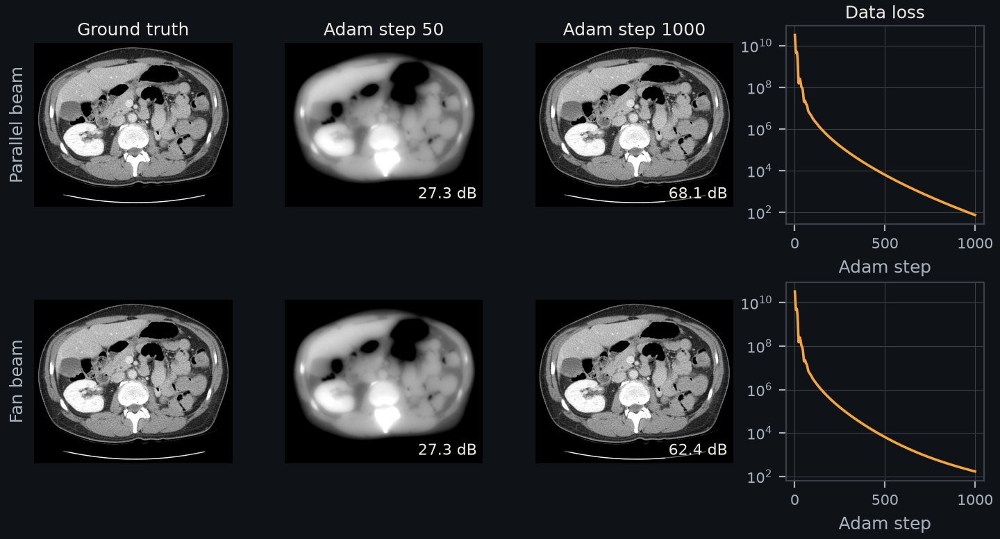
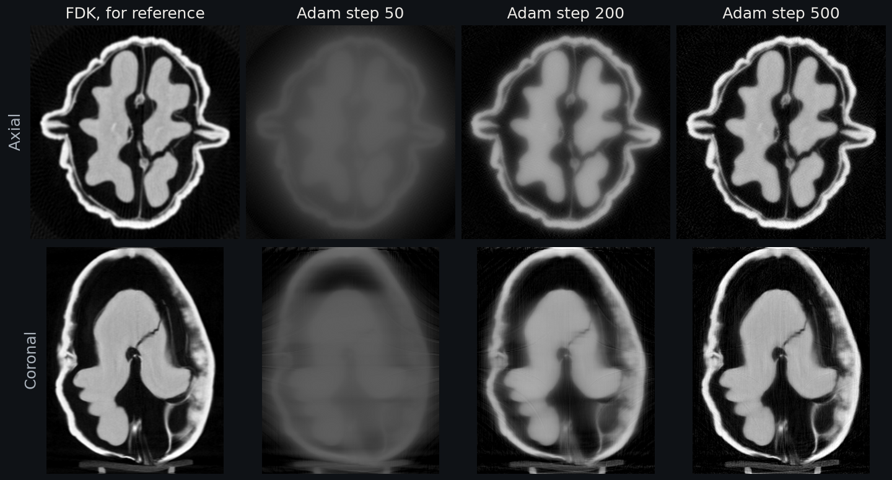

Gradient-Based Iterative Reconstruction
=======================================

The volume is a tensor of parameters. The differentiable forward projector maps
it to projections, a loss compares them with the measurement, and a PyTorch
optimizer updates the volume. Autograd computes the gradient with the matched
adjoint ``A^T``, so no backprojection code is written by hand.

The same loop takes other losses, regularizers, constraints and network
parameters. For least squares without extra terms, the :func:`~diffct.solvers.cgls`
and :func:`~diffct.solvers.sirt` solvers converge in fewer iterations.

Objective
---------

For a projector ``A`` and measured projections ``y``, the examples minimize the
mean squared error over a nonnegative volume ``x``:

.. math::
   \hat{x} = \arg\min_{x \ge 0} \tfrac{1}{M} \lVert A x - y \rVert_2^2

``M`` is the number of measured values. After each Adam step, ``x`` is clamped
to zero or more.

2D parallel and fan beam
------------------------

   The loop below at 512², with 720 views, Adam learning rate 0.1, 1000 steps and
   the abdominal slice of TCIA case L213 as ground truth (see :ref:`data-sources`). PSNR uses the
   peak of the ground truth. The code below uses a 128² square so that it runs in
   seconds.

.. tab-set::

   .. tab-item:: Parallel beam

      .. code-block:: python

         import torch
         from diffct import Projector, circular_trajectory_2d_parallel

         n, n_views, n_det = 128, 360, 384
         trajectory = circular_trajectory_2d_parallel(n_views, device="cuda")
         A = Projector(trajectory, (n, n), n_det, beam="parallel", detector_spacing=0.5)

         truth = torch.zeros((n, n), device="cuda")
         truth[40:88, 40:88] = 1.0
         measured = A.project(truth).detach()

         image = torch.zeros((n, n), device="cuda", requires_grad=True)
         optimizer = torch.optim.Adam([image], lr=0.1)
         for step in range(500):
             optimizer.zero_grad()
             loss = 0.5 * (A.project(image) - measured).square().sum()
             loss.backward()
             optimizer.step()
             with torch.no_grad():
                 image.clamp_(min=0)

   .. tab-item:: Fan beam

      .. code-block:: python

         import torch
         from diffct import Projector, circular_trajectory_2d_fan

         n, n_views = 128, 360
         sid, sdd, n_det, pitch = 2.5 * n, 4.0 * n, 3 * n, 0.8
         trajectory = circular_trajectory_2d_fan(n_views, sid, sdd, device="cuda")
         A = Projector(trajectory, (n, n), n_det, beam="fan", detector_spacing=pitch)

         truth = torch.zeros((n, n), device="cuda")
         truth[40:88, 40:88] = 1.0
         measured = A.project(truth).detach()

         image = torch.zeros((n, n), device="cuda", requires_grad=True)
         optimizer = torch.optim.Adam([image], lr=0.1)
         for step in range(500):
             optimizer.zero_grad()
             loss = 0.5 * (A.project(image) - measured).square().sum()
             loss.backward()
             optimizer.step()
             with torch.no_grad():
                 image.clamp_(min=0)

The 2D loops use the summed squared error; its gradient differs from the mean
only by a constant factor, and Adam steps are nearly invariant to such a factor.

3D measured walnut
------------------

   240 measured cone-beam views of a walnut, 256³ volume, Adam with learning
   rate 0.01. The FDK column is a reference only; the loop starts from zero.

The measured projections are scaled so that the walnut shell is about 1, as in
``examples/walnut_reconstruction.py``:

.. code-block:: python

   import torch
   from diffct import Projector

   # trajectory, detector shape and spacing from examples/walnut_reconstruction.py
   A = Projector(trajectory, (256, 256, 256), detector, detector_spacing=(du, dv), voxel_spacing=voxel)

   volume = torch.zeros(A.volume_shape, device="cuda", requires_grad=True)
   optimizer = torch.optim.Adam([volume], lr=0.01)
   for step in range(500):
       optimizer.zero_grad()
       loss = torch.nn.functional.mse_loss(A.project(volume), measured)
       loss.backward()
       optimizer.step()
       with torch.no_grad():
           volume.clamp_(min=0)

The full script is the ``gradient`` command of ``docs/assets/gallery/compute.py``.

Variations
----------

- **Regularization:** add a penalty to the loss, for example
  ``loss = loss + weight * diffct.total_variation(volume, voxel_spacing=voxel)``.
  :func:`~diffct.solvers.tv_reconstruction` packages this loop with residual
  history and checkpoints.
- **Learned components:** replace the volume tensor with the output of a network,
  or make trajectory tensors trainable to calibrate the geometry; see
  :doc:`trajectories`.
- **Large volumes and several GPUs:** the same loop works with the
  ``devices`` and ``distributed`` options of ``Projector``; see :doc:`multi_gpu`.
- **Stopping:** the learning rate and step count are starting values. On real data,
  stop with a rule that does not use a ground truth.
