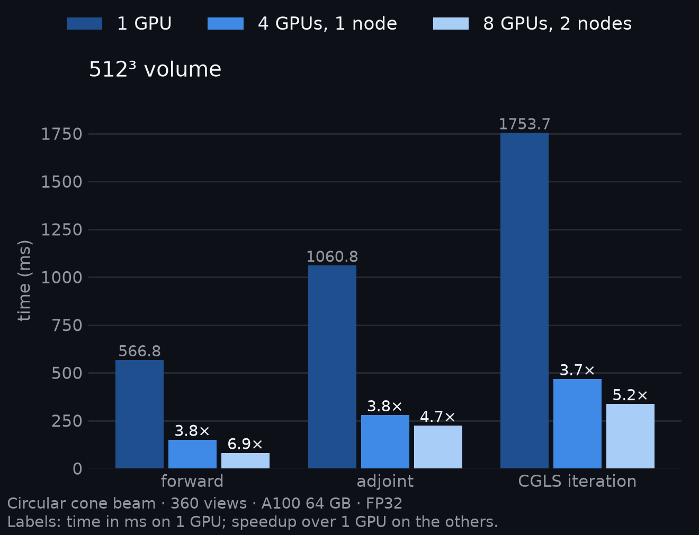

:html_theme.sidebar_secondary.remove:

diffct
======

.. raw:: html

   <section class="hero">
     

       
Differentiable CT operators for PyTorch

       
Differentiable CUDA projectors for CT: arbitrary trajectories,
       multi-GPU, multi-node, geometry gradients.

       

         <a class="hero-button primary" href="getting_started.html">Get started</a>
         <a class="hero-button" href="examples.html">Examples</a>
         <a class="hero-button" href="api.html">API reference</a>
       

       <pre class="hero-install"><code>pip install "diffct[cu12]"</code></pre>
     

     

       
     

   </section>

diffct provides differentiable CUDA projectors and matched adjoints for computed
tomography (CT) in PyTorch. It supports 2D parallel and fan beams and 3D cone
and parallel beams. Each view can follow any trajectory, and autograd gives
gradients for the volume and for trajectory tensors. Detector pixels can follow
parameterized surfaces, with first-order gradients for their parameters. Views
can be split across several GPUs.

Code written for diffct 1.x must be updated; see :doc:`migration`.

Features
--------

.. grid:: 1 2 2 4
   :gutter: 3
   :class-container: feature-grid

   .. grid-item-card:: Arbitrary trajectories
      :link: trajectories
      :link-type: doc

      Each view has its own ray direction or source, detector centre and
      detector axes. Circular, helical, saddle, sinusoidal, random and
      calibrated scans use the same code.

   .. grid-item-card:: Geometry gradients
      :link: trajectories
      :link-type: doc

      Trajectory tensors with ``requires_grad=True`` receive gradients.
      Use them to calibrate angles, detector shifts and rigid transforms.

   .. grid-item-card:: Curved detectors
      :link: detector-surfaces
      :link-type: ref

      ``ParameterizedSurface`` defines native arc, cylindrical or arbitrary
      pixels. Projection and matched backprojection support first-order
      surface gradients.

   .. grid-item-card:: Matched operators
      :link: api
      :link-type: doc

      ``project()`` and ``backproject()`` form an exact adjoint pair for the
      cell-constant Siddon model, with volume and sinogram gradients and
      Hessian-vector products.

   .. grid-item-card:: Large volumes
      :link: chunking
      :link-type: doc

      Automatic spatial, view and pixel blocks control working memory.
      ``project_into`` and ``backproject_into`` accept caller-owned tensor or
      disk stores.

   .. grid-item-card:: Multi-GPU and multi-node
      :link: multi_gpu
      :link-type: doc

      Use ``devices=[0, 1, 2, 3]`` in one process, or ``torchrun`` and NCCL
      across ranks. Partition by views, space or both.

   .. grid-item-card:: Backends and precision
      :link: execution
      :link-type: doc

      A native CUDA backend and a portable PyTorch backend for CPU, CUDA and
      ROCm. FP32 and FP64 modes, per-axis voxel spacing and batch dimensions.

   .. grid-item-card:: Reconstruction
      :link: analytical_learning
      :link-type: doc

      Differentiable ``fbp``, ``fdk`` and approximate ``helical_fdk`` with
      learnable filters and weights. ``cgls``, ``sirt`` and
      ``tv_reconstruction`` solvers.

Install
-------

.. tab-set::

   .. tab-item:: CUDA 12

      .. code-block:: bash

         pip install "diffct[cu12]"

      Install a CUDA 12 build of PyTorch first. The extra installs the CUDA
      compiler libraries that Numba CUDA needs.

   .. tab-item:: CUDA 13

      .. code-block:: bash

         pip install "diffct[cu13]"

      Install a CUDA 13 build of PyTorch first. The extra installs the CUDA
      compiler libraries that Numba CUDA needs.

   .. tab-item:: CPU or ROCm

      .. code-block:: bash

         pip install diffct

      Install the PyTorch build for your device, then use ``backend="torch"``.
      Importing diffct and using this backend require no CUDA runtime.

   .. tab-item:: From source

      .. code-block:: bash

         git clone https://github.com/sypsyp97/diffct.git
         cd diffct && pip install -e ".[cu12]"
         python examples/quickstart.py

Backend, precision and solver contracts are in :doc:`execution`.

Quickstart
----------

Create the acquisition once. Then call ``project()`` and ``backproject()``.

.. tab-set::

   .. tab-item:: CUDA

      .. code-block:: python

         import torch
         from diffct import Projector, spiral_trajectory_3d

         trajectory = spiral_trajectory_3d(360, sid=320.0, sdd=512.0, z_range=40.0, n_turns=1.0, device="cpu")
         A = Projector(trajectory, volume_shape=(128, 128, 128), detector_shape=(384, 256), detector_spacing=0.8)

         volume = torch.rand(A.volume_shape, device="cuda")
         sinogram = A.project(volume)        # (360, 384, 256) line integrals
         adjoint = A.backproject(sinogram)   # matched adjoint A^T

         x = torch.zeros_like(volume, requires_grad=True)
         loss = 0.5 * (A.project(x) - sinogram).square().sum()
         loss.backward()                     # x.grad = A^T (A x - y)

   .. tab-item:: CPU (PyTorch backend)

      .. code-block:: python

         import torch
         from diffct import Projector, spiral_trajectory_3d

         trajectory = spiral_trajectory_3d(90, sid=160.0, sdd=256.0, z_range=20.0, n_turns=1.0, device="cpu")
         A = Projector(trajectory, volume_shape=(64, 64, 64), detector_shape=(192, 128), detector_spacing=0.8,
                       backend="torch")

         volume = torch.rand(A.volume_shape)
         sinogram = A.project(volume)        # (90, 192, 128) line integrals
         adjoint = A.backproject(sinogram)   # matched adjoint A^T

         x = torch.zeros_like(volume, requires_grad=True)
         loss = 0.5 * (A.project(x) - sinogram).square().sum()
         loss.backward()                     # x.grad = A^T (A x - y)

See :doc:`getting_started` for shapes, devices and troubleshooting.

Gallery
-------

.. grid:: 1 2 3 3
   :gutter: 3
   :class-container: gallery-grid

   .. grid-item-card:: Measured walnut
      :link: walnut_example
      :link-type: doc
      :img-top: _static/gallery/walnut.png
      :img-alt: FDK, SIRT, CGLS and TV slices of a measured walnut

      FDK, SIRT, CGLS and TV on 240 measured cone-beam views.

   .. grid-item-card:: Cone-beam iterative
      :link: iterative_reco_cone_example
      :link-type: doc
      :img-top: _static/gallery/iterative_cone.png
      :img-alt: Coronal slices of a simulated helical scan

      CGLS, SIRT and TV on circular, helical, saddle or sinusoidal scans.

   .. grid-item-card:: Learnable FBP
      :link: analytical_learning
      :link-type: doc
      :img-top: _static/gallery/analytical_learning.png
      :img-alt: FBP with the Ram-Lak filter and a learned filter

      Learn the FBP filter through autograd.

See all examples in the :doc:`examples` gallery.

Performance
-----------

.. image:: ../assets/scaling_light.png
   :class: only-light
   :alt: Time per forward, adjoint and CGLS iteration on 1, 4 and 8 GPUs, 512^3 volume

.. list-table::
   :header-rows: 1
   :class: performance-table

   * - 512³ volume
     - 1 GPU
     - 4 GPUs, 1 node
     - 8 GPUs, 2 nodes
   * - Forward projection
     - 566.79 ms
     - 150.76 ms (3.8×)
     - 81.58 ms (6.9×)
   * - Adjoint (backprojection)
     - 1060.77 ms
     - 279.37 ms (3.8×)
     - 224.04 ms (4.7×)
   * - CGLS iteration
     - 1753.73 ms
     - 468.09 ms (3.7×)
     - 337.39 ms (5.2×)

diffct 2.4.3, FP32, A100 64 GB GPUs; circular cone beam, 360 views, 1024×768
detector, pitch 1.25. Default memory settings, without an imposed allocator cap.
Projection times are medians of seven samples after three warmups. CGLS uses
three ten-iteration solves after a two-iteration warmup; the median includes
initialization and is divided by ten. Raw samples and configuration:
`scaling.json <https://github.com/sypsyp97/diffct/blob/main/docs/assets/scaling.json>`_.

Citation and license
--------------------

For software and technical-report citations, see the
`README <https://github.com/sypsyp97/diffct/blob/main/README.md#citation>`_.
The project uses the
`Apache 2.0 license <https://github.com/sypsyp97/diffct/blob/main/LICENSE>`_.
This site documents the source checkout, including
`unreleased APIs <https://github.com/sypsyp97/diffct/blob/main/CHANGELOG.md#unreleased>`_.

.. toctree::
   :hidden:

   getting_started
   user_guide
   examples
   api
   changelog
